<picture>
  <source media="(prefers-color-scheme: dark)" srcset="docs/img/banner-escuro.svg">
  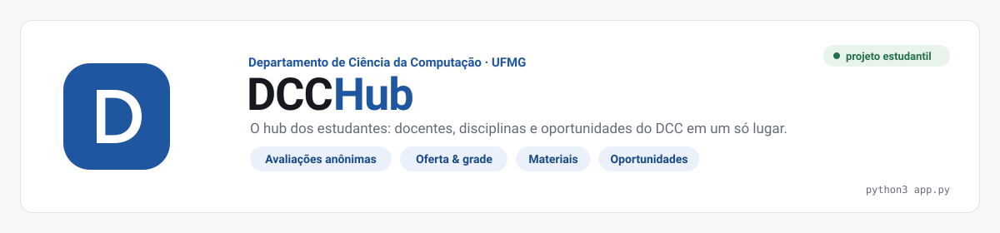
</picture>

<p align="center">
  <a href="#começando">Começando</a> ·
  <a href="docs/dados.md">Dados</a> ·
  <a href="docs/moderacao.md">Moderação</a> ·
  <a href="docs/comunidade-e-privacidade.md">Comunidade e privacidade</a> ·
  <a href="docs/deploy.md">Deploy</a> ·
  <a href="docs/desenvolvimento.md">Desenvolvimento</a>
</p>

---

**DCCHub** reúne num só lugar o que estudantes do Departamento de Ciência da Computação da UFMG procuram a cada semestre: **avaliações anônimas** de docentes e disciplinas ligadas à oferta oficial, **montador de grade** com conflitos de horário, **materiais** (provas antigas) e **oportunidades** de pesquisa, bolsas e estágios.

> [!IMPORTANT]
> Projeto **independente** de estudantes, sem vínculo com o DCC ou a UFMG. Feito para uso da comunidade estudantil: acesso pelo e-mail `@ufmg.br` (sem conta, e o e-mail não é guardado) ou por código, fora de buscadores. Veja [Comunidade e privacidade](docs/comunidade-e-privacidade.md).

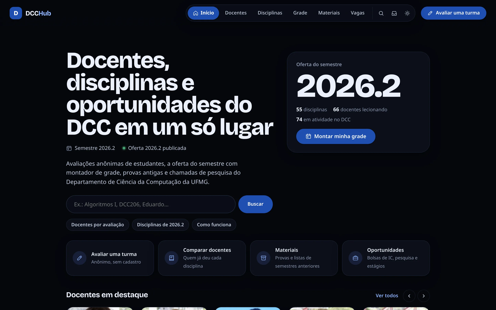

## O que tem

| | |
|---|---|
| **Oferta & grade** | Todas as turmas do semestre com a nota do docente *naquela disciplina*, filtros por turno e dia, e uma grade semanal que acusa conflitos (salva no navegador) e exporta para o calendário (`.ics`). |
| **Grade por curso** | Escolha seu curso e período e a lista começa pelo que você precisa cursar agora, com as obrigatórias de outros períodos e as optativas separadas. Disciplinas de fora do DCC (Cálculo, Probabilidade…) aparecem também, e o horário delas entra na grade à mão. Currículos dos relatórios oficiais da PROGRAD. |
| **Docentes** | Foto, áreas, sala e links; resumo das notas; nota **por disciplina**; **evolução por semestre** (clique num semestre para ver as avaliações dele); histórico de turmas desde 2020 com planos de ensino; oportunidades abertas que citam o docente. |
| **Disciplinas** | Turmas do semestre, **comparação de quem já deu a disciplina** (didática, dificuldade para aprender e para passar, carga…), evolução da nota por semestre, histórico de ofertas e materiais. Avaliações filtráveis por semestre. |
| **Avaliações** | Geral, didática, avaliações justas, dificuldade **para aprender** e **para passar** (separadas: matéria difícil pode ter prova tranquila, e vice-versa) e carga (1–5); "faria de novo?"; conceito; marcadores; comentário. Selo de **turma confirmada** quando a oferta oficial bate. Rankings por média bayesiana. |
| **Materiais** | Índice do acervo de provas antigas mantido pelos estudantes no Google Drive, ligado a cada disciplina. |
| **Oportunidades** | Chamadas de IC, bolsas e estágios de [dcc.ufmg.br/oportunidades](https://dcc.ufmg.br/oportunidades/), com filtros por tipo, público e área. |
| **Moderação automática** | Filtro que publica, devolve para reescrever ou segura para revisão — mostrando o motivo **enquanto a pessoa digita**. [Como funciona →](docs/moderacao.md) |
| **Anonimato com controle** | Sem cadastro; editar e apagar as próprias avaliações; código de recuperação para trocar de navegador. |
| **Leve e acessível** | Sem dependências nem build, sem scripts ou fontes de terceiros (a fonte dos títulos é servida pelo próprio site), temas escuro e claro, celular e teclado (`/` abre a busca). |

<table>
  <tr>
    <td width="50%">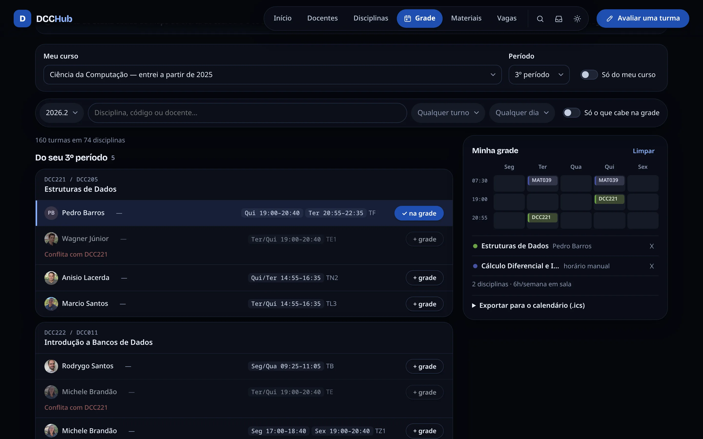<br><sub><b>Grade</b> — seu período primeiro, conflitos de horário e disciplinas de fora do DCC</sub></td>
    <td width="50%">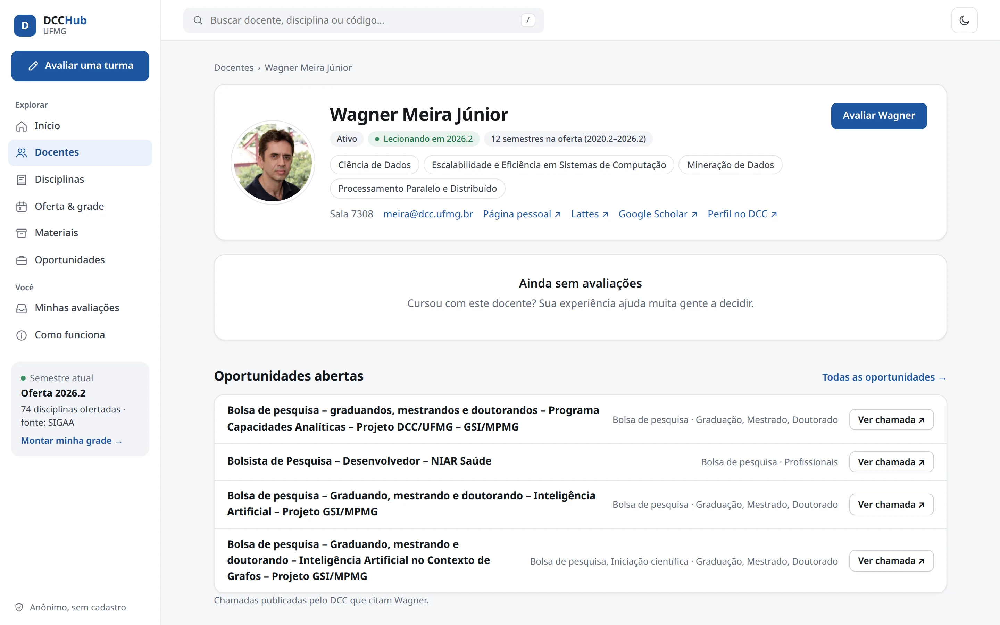<br><sub><b>Docente</b> — perfil, histórico e oportunidades abertas</sub></td>
  </tr>
  <tr>
    <td>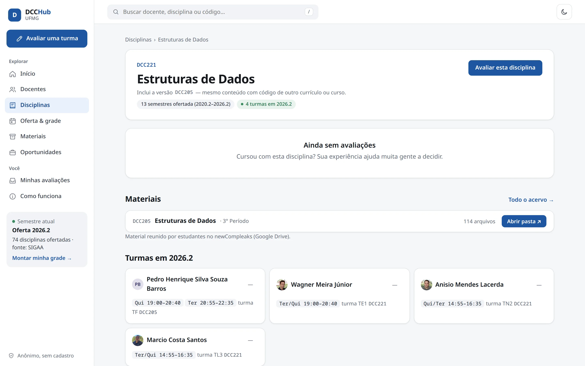<br><sub><b>Disciplina</b> — turmas, comparação de docentes e materiais</sub></td>
    <td>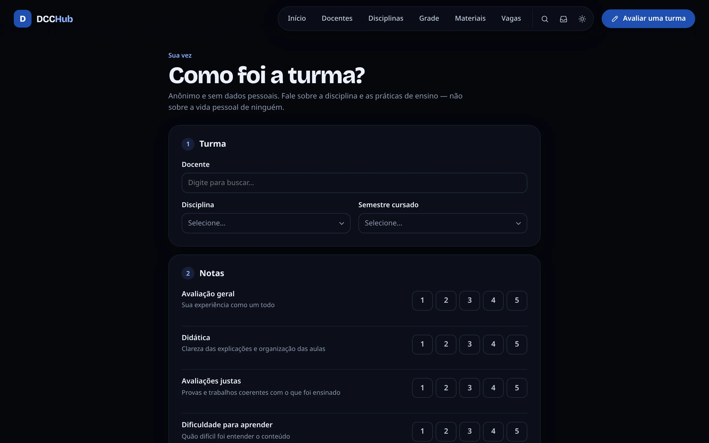<br><sub><b>Avaliar</b> — várias dimensões, rascunho automático</sub></td>
  </tr>
  <tr>
    <td>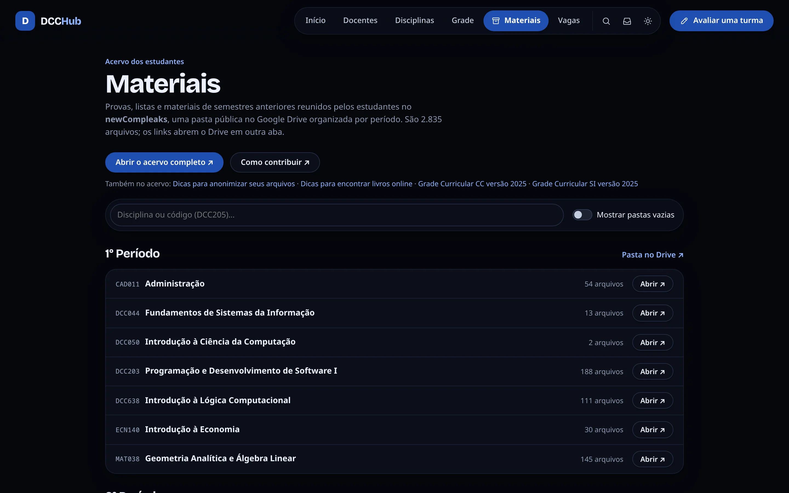<br><sub><b>Materiais</b> — provas antigas por disciplina</sub></td>
    <td>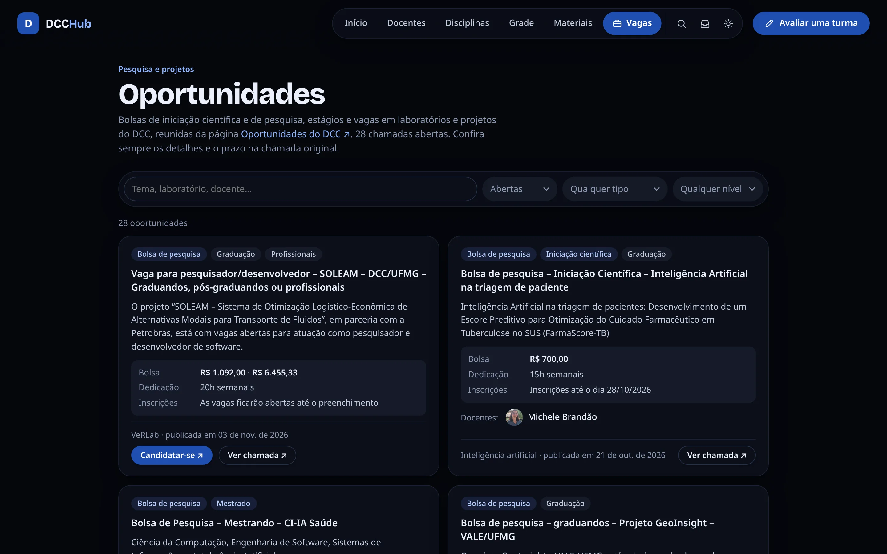<br><sub><b>Oportunidades</b> — IC, bolsas e estágios</sub></td>
  </tr>
  <tr>
    <td>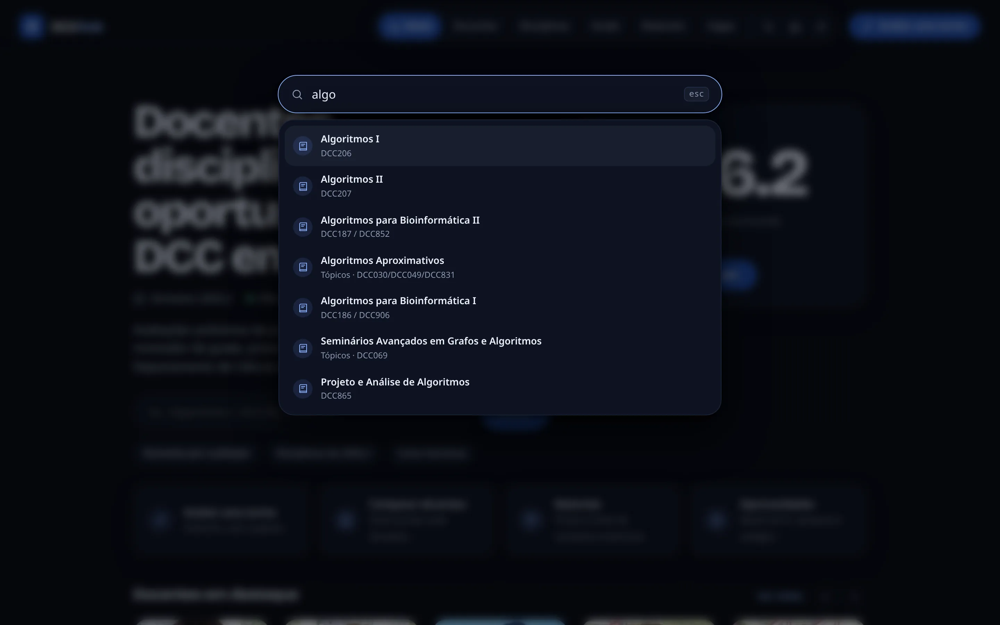<br><sub><b>Busca</b> — docentes e disciplinas por nome ou código (<code>/</code>)</sub></td>
    <td>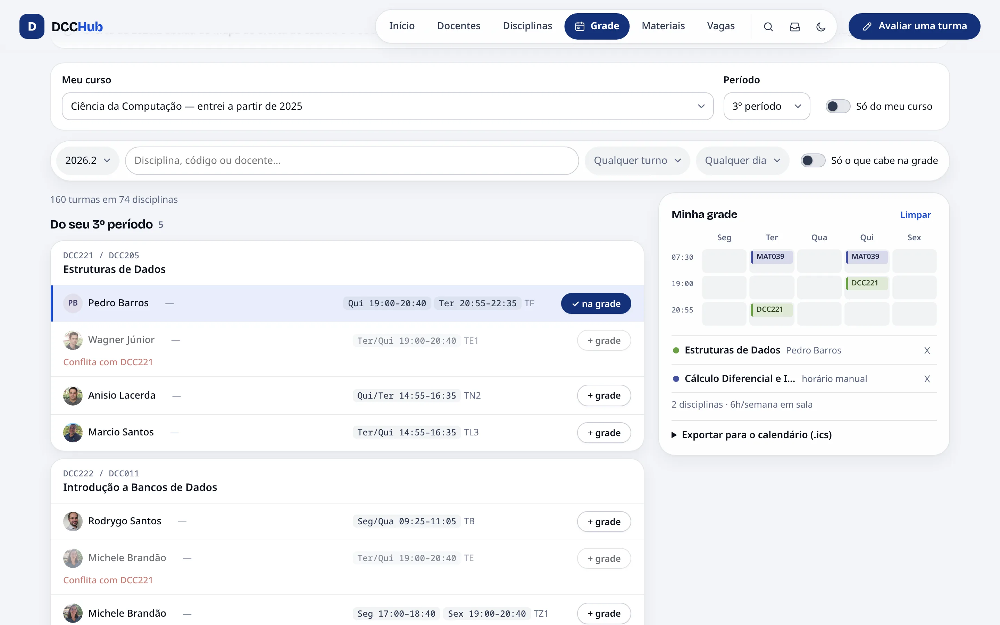<br><sub><b>Tema claro</b> — os mesmos componentes, escolhidos no botão do topo</sub></td>
  </tr>
</table>

<details>
<summary><b>Tema claro e celular</b></summary>
<br>

<p align="center">
  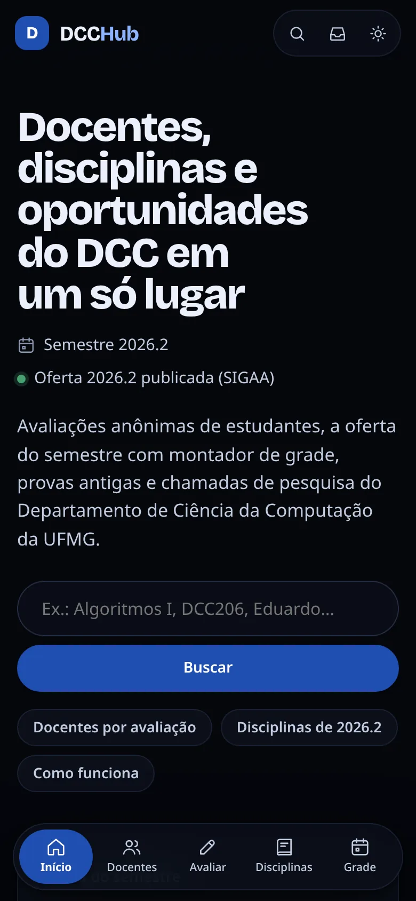
  &nbsp;&nbsp;
  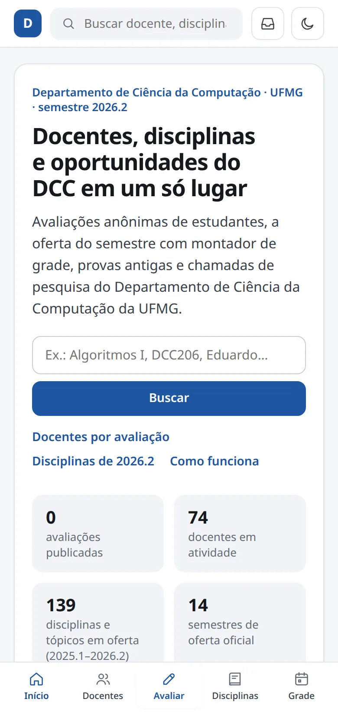
</p>
</details>

<sub>Capturas com o banco vazio: nenhuma avaliação mostrada aqui é real ou inventada.</sub>

## Começando

Só precisa de **Python 3.10+** — nada para instalar. O catálogo (docentes, disciplinas e turmas desde 2020) já vem em `data/`.

```bash
python3 app.py                 # http://localhost:8000
```

Com avaliações fictícias para explorar a interface:

```bash
python3 tests/seed_demo.py /tmp/demo.db
DCCHUB_DB=/tmp/demo.db python3 app.py
```

Com o painel de moderação (`/#/moderacao`) e o acesso restrito à comunidade — por e-mail `@ufmg.br` (sem SMTP configurado, o código aparece no terminal) e/ou por código:

```bash
DCCHUB_ADMIN_TOKEN=um-token-longo DCCHUB_EMAIL_LOGIN=1 DCCHUB_ACCESS_CODES=codigo-do-semestre python3 app.py
```

Todas as variáveis estão em [Desenvolvimento → Configuração](docs/desenvolvimento.md#configuração).

## Atualizando os dados

| Comando | O que faz | Quando |
|---|---|---|
| `python3 scripts/sync_dcc.py` | Docentes, disciplinas e ofertas do site do DCC | início do semestre / semanal |
| `python3 scripts/sync_oportunidades.py` | Chamadas de oportunidades | diário |
| `python3 scripts/sync_provas.py` | Índice do acervo de materiais | semanal |
| `python3 scripts/import_sigaa.py mapa.pdf` | Oferta pelo SIGAA quando o DCC ainda não publicou | quando precisar |
| `python3 scripts/audit_catalog.py` | Confere o catálogo contra todas as ofertas oficiais | após mudanças no sync |

O servidor recarrega o catálogo sozinho quando os arquivos mudam. Detalhes de cada fonte em [Dados](docs/dados.md).

## Colocando no ar

Uma VM mínima com Docker basta (o app usa ~30 MB de RAM). `deploy/` tem `docker-compose.yml` com HTTPS automático via Caddy, cron de atualização, backup (com cópia cifrada fora da VM) e monitor de disponibilidade. Passo a passo para **Azure for Students**, **Oracle Cloud** ou qualquer VPS em [Deploy](docs/deploy.md).

```bash
cd deploy && cp .env.example .env   # DOMAIN, DCCHUB_ADMIN_TOKEN, acesso por e-mail/código, SMTP
docker compose up -d --build
```

## Documentação

- [**Dados**](docs/dados.md) — de onde vem cada informação, como nomes e versões de disciplina são resolvidos, auditoria.
- [**Moderação**](docs/moderacao.md) — as três decisões, categorias, burlas cobertas, como foi avaliado e limites.
- [**Comunidade e privacidade**](docs/comunidade-e-privacidade.md) — acesso por e-mail @ufmg.br e por código, anonimato, o que o banco guarda.
- [**Deploy**](docs/deploy.md) — VM com Docker, HTTPS, cron, backup e atualização.
- [**Desenvolvimento**](docs/desenvolvimento.md) — arquitetura, configuração, API, testes.

---

<sub>Criado e mantido por [Thales Amaral](https://github.com/amaralthalesalves). Inspirado no que funciona em RateMyProfessors, UW Flow, GDE/Unicamp e MatrUSP — e evitando nota única sem contexto, rankings enviesados por poucas avaliações e ataques pessoais.</sub>
