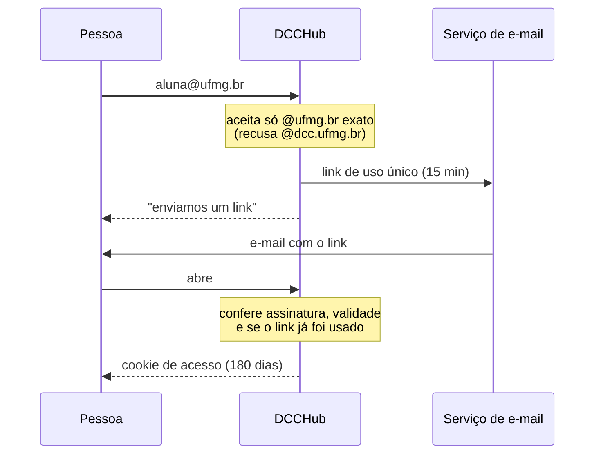

# Comunidade e privacidade

[← README](../README.md)

O DCCHub é um projeto **independente** de estudantes, sem vínculo com o DCC ou a UFMG — isso aparece no rodapé, na tela de acesso e em "Como funciona". Ele existe para a comunidade estudantil e é desenhado para ficar com ela.

## Fora do alcance público

| Medida | Como |
|---|---|
| **E-mail @ufmg.br** | Com `DCCHUB_EMAIL_LOGIN=1`, entra quem recebe um link no e-mail institucional. Sem conta, e o e-mail não é guardado. |
| **Código de acesso** | Com `DCCHUB_ACCESS_CODES` definido, também entra quem digita um código válido. Sem nenhum dos dois, a API não entrega dados; o site mostra só a tela de acesso. |
| **Fora de buscadores** | `robots.txt` bloqueia tudo; toda resposta leva `X-Robots-Tag: noindex` e a página tem `<meta name="robots" content="noindex">`. O nome de um docente numa busca não leva ao site. |
| **Sem marca institucional** | Nome, logo e textos não imitam DCC/UFMG e deixam claro que é um projeto independente. |

### Acesso pelo e-mail @ufmg.br

- **Só `@ufmg.br` exato.** Todo aluno tem um. `@dcc.ufmg.br` — o domínio que os docentes do DCC divulgam — e outros subdomínios são recusados, então digitar o endereço público de um docente **não dispara e-mail nenhum** para ele.
- **O e-mail não é guardado.** Só passa pela memória durante o envio: não vai para o banco nem para logs (inclusive mensagens de erro de envio). O limite de 3 links por endereço por hora usa um HMAC do endereço que fica só em memória e some ao fim da janela.
- **O link** é um token assinado, válido por 15 minutos e de **uso único**; não contém o e-mail. Ele fica no fragmento da URL (`#/entrar?t=…`), que não é enviado ao servidor quando o link é aberto — assim, antivírus de e-mail que "visitam" links não conseguem gastá-lo.
- **O cookie de acesso** também não contém nada do e-mail e é **independente da identidade anônima** de quem avalia (`avalia_dcc`). Saber quem pediu um link não diz nada sobre quem escreveu cada avaliação.
- **Revogar:** trocar `DCCHUB_EMAIL_EPOCH` desconecta todo mundo que entrou por e-mail.
- **O e-mail é neutro:** "Seu link de acesso", sem falar em avaliações, docentes ou disciplinas.

> [!NOTE]
> O serviço de envio (Brevo, SES…) registra para quem enviou cada e-mail e quando — isso fica fora do DCCHub. Como o acesso não tem ligação com as avaliações, esse registro mostra quem *entrou* no site, não o que cada pessoa escreveu. Para dificultar o cruzamento por horário ("link às 14:02, avaliação às 14:05"), o banco guarda a data das avaliações **só com precisão de dia**. Num dia com pouquíssimo movimento, o cruzamento por dia ainda seria possível para quem tivesse o log do serviço *e* o banco — por isso, os dois ficam só com quem mantém o site.

### O código de acesso
- Divulgue **só nos canais dos estudantes** (grupos de turma, DA, Discord…).
- Aceita vários códigos separados por vírgula — por exemplo, um por semestre.
- O navegador guarda um **HMAC do código** (cookie `HttpOnly`, 180 dias), nunca o código em si. **Trocar o código revoga** todo mundo que entrou com o antigo.
- O código não identifica ninguém: o anonimato continua igual.

> [!NOTE]
> Não existe garantia absoluta: qualquer pessoa com o código (monitores, pós-graduandos…) pode ver ou repassar. A melhor proteção continua sendo o **conteúdo ser defensável** — regras claras, [moderação automática](moderacao.md) e denúncias.

## Anonimato

- **Sem cadastro.** O navegador recebe um token aleatório em cookie `HttpOnly`, `SameSite=Strict`.
- O banco guarda só `HMAC-SHA256(segredo, token)` — nem o token, nem nada que identifique a pessoa.
- **Data só com o dia.** A data de cada avaliação é guardada sem hora ("hoje", "ontem", "há 3 dias").
- **Nenhum log de acesso com IP.** O IP só é usado em memória para limitar abusos (ex.: 6 avaliações a cada 10 min, 60 votos por minuto) e é descartado.
- Quem escreveu pode **editar e apagar** as próprias avaliações. O **código de recuperação** leva a identidade anônima para outro navegador.

### O que o banco guarda

| Tabela | Conteúdo |
|---|---|
| `reviews` | Docente, disciplina, semestre, notas, marcadores, comentário, situação (publicada/segurada/removida), hash do autor, datas |
| `votes` | Voto "útil": avaliação + hash de quem votou |
| `reports` | Denúncias: avaliação + hash de quem denunciou + motivo |
| `class_reports` | Relatos "docente X dá a disciplina Y neste semestre" + hash de quem relatou |
| `used_links` | Identificador aleatório de cada link de acesso já usado, até ele expirar (para o uso único). Sem e-mail. |

Comentários recusados pela moderação **não são guardados**.

## Segurança

- Content-Security-Policy restritiva, sem nenhum recurso de terceiros (fontes, scripts, analytics).
- Checagem de `Origin` em toda escrita; limite de tamanho do corpo; campo-armadilha contra bots.
- Consultas SQL sempre parametrizadas.
- Painel de moderação protegido por `DCCHUB_ADMIN_TOKEN` (`Authorization: Bearer …`).

## A chave secreta

O segredo do HMAC fica em `secret.key`, ao lado do banco (ou em `DCCHUB_SECRET`). **Faça backup dele junto com o banco**: com uma chave nova, ninguém consegue mais editar ou apagar as próprias avaliações, e os códigos de acesso salvos nos navegadores deixam de valer. O `deploy/backup.sh` já copia os dois.

## Dados de terceiros

- O catálogo vem só de **páginas públicas** do DCC. As fotos são baixadas no sync e servidas localmente, para que o navegador de quem usa não acesse terceiros.
- Da oferta do SIGAA, guardam-se só código, título, turma, horário e nome dos docentes — veja [Dados → SIGAA](dados.md#oferta-pelo-sigaa--import_sigaapy). O PDF nunca entra no repositório nem na imagem Docker.
