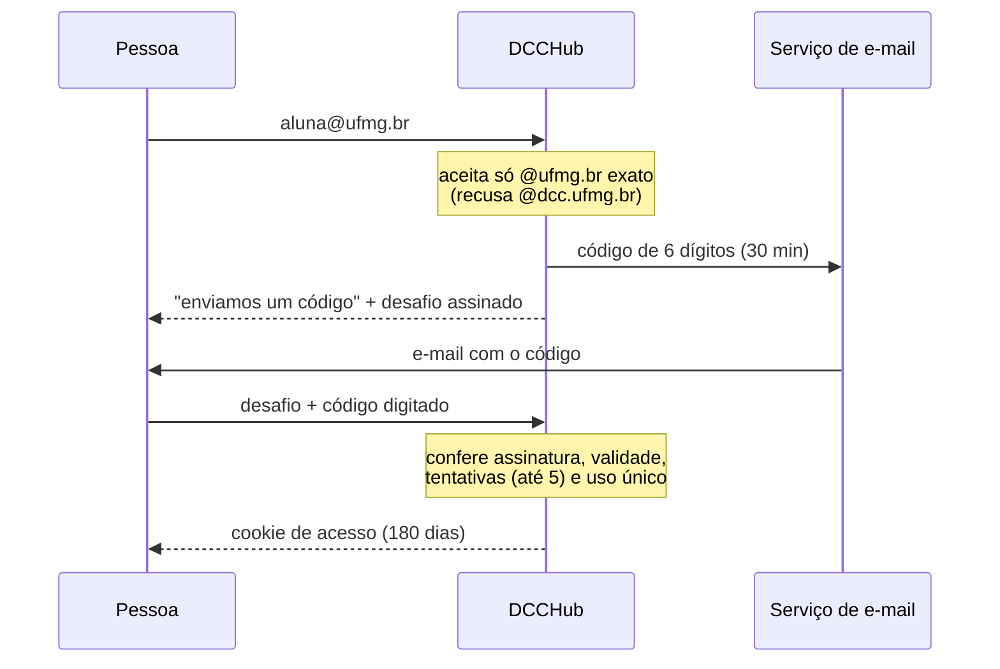

# Comunidade e privacidade

[← README](../README.md)

O DCCHub é um projeto **independente** de estudantes, sem vínculo com o DCC ou a UFMG — isso aparece no rodapé, na tela de acesso e em "Como funciona". Ele existe para a comunidade estudantil e é desenhado para ficar com ela.

## Fora do alcance público

| Medida | Como |
|---|---|
| **E-mail @ufmg.br** | Com `DCCHUB_EMAIL_LOGIN=1`, entra quem recebe um código de 6 dígitos no e-mail institucional. Sem conta, e o e-mail não é guardado. |
| **Código de acesso** | Com `DCCHUB_ACCESS_CODES` definido, também entra quem digita um código válido. Sem nenhum dos dois, a API não entrega dados; o site mostra só a tela de acesso. |
| **Fora de buscadores** | `robots.txt` bloqueia tudo; toda resposta leva `X-Robots-Tag: noindex` e a página tem `<meta name="robots" content="noindex">`. O nome de um docente numa busca não leva ao site. |
| **Sem marca institucional** | Nome, logo e textos não imitam DCC/UFMG e deixam claro que é um projeto independente. |

### Acesso pelo e-mail @ufmg.br

- **Só `@ufmg.br` exato.** Todo aluno tem um. `@dcc.ufmg.br` — o domínio que os docentes do DCC divulgam — e outros subdomínios são recusados, então digitar o endereço público de um docente **não dispara e-mail nenhum** para ele.
- **O e-mail não é guardado.** Só passa pela memória durante o envio: não vai para o banco nem para logs — erros de envio registram só o tipo e o código SMTP, porque o texto dessas exceções costuma trazer o endereço. O limite de 3 e-mails por endereço por hora usa um HMAC do endereço que fica só em memória e some ao fim da janela.
- **O código** tem 6 dígitos, vale 30 minutos e é de **uso único**. São 30 minutos, e não 10, porque o correio da UFMG — e o redirecionamento para outras caixas — chega a levar vários minutos; o prazo não muda a chance de chute, que depende só das tentativas. Junto com o envio, o navegador recebe um *desafio*: um token assinado com a chave do servidor que amarra o código sem contê-lo e não traz nada do e-mail. Sem a chave, não dá para testar códigos fora do ar; online, são **no máximo 5 tentativas por código** — 5 chances em 1.000.000 por e-mail enviado, que já é limitado por endereço, por rede e por dia.
- **E-mail lento:** o navegador guarda os desafios dos últimos 3 códigos pedidos, e qualquer um deles serve — quem cansa de esperar e pede outro pode usar o primeiro que chegar. Pedir de novo só é liberado 60 segundos depois do último envio.
- **Funciona entre aparelhos:** dá para ler o e-mail no celular e digitar o código no computador. E, como o e-mail não tem link, antivírus que "visitam" links não atrapalham, e ninguém se acostuma a clicar em link de login vindo por e-mail.
- **O cookie de acesso** também não contém nada do e-mail e é **independente da identidade anônima** de quem avalia (`avalia_dcc`). Saber quem pediu um código não diz nada sobre quem escreveu cada avaliação.
- **Revogar:** trocar `DCCHUB_EMAIL_EPOCH` desconecta todo mundo que entrou por e-mail. Não dá para revogar uma pessoa só: o cookie não diz de quem é (é o preço de não guardar o e-mail).
- **Cota de envio:** no máximo 20 códigos por conexão por dia e `DCCHUB_EMAIL_DAILY_LIMIT` (padrão 250) no total, para que ninguém esgote a cota do serviço de e-mail e trave o acesso de todo mundo.
- **O e-mail é neutro:** "123456 é seu código de acesso ao DCCHub", sem falar em avaliações, docentes ou disciplinas. O código vai no assunto para aparecer direto na notificação do celular.

> [!NOTE]
> O serviço de envio (Gmail, Brevo…) registra para quem enviou cada e-mail e quando — isso fica fora do DCCHub. Como o acesso não tem ligação com as avaliações, esse registro mostra quem *entrou* no site, não o que cada pessoa escreveu. Para dificultar o cruzamento por horário ("código às 14:02, avaliação às 14:05"), o banco guarda a data das avaliações **só com precisão de dia**. Num dia com pouquíssimo movimento, o cruzamento por dia ainda seria possível para quem tivesse o log do serviço *e* o banco — por isso, os dois ficam só com quem mantém o site.

### Modo docente (experimental, desligado por padrão)

Com `DCCHUB_DOCENTE_LOGIN=1`, o e-mail que um docente publica no site do DCC (a lista vem do catálogo; inclusive os
poucos que são `@ufmg.br`) também recebe um código. Ele não dá acesso ao site: o docente vê **só a própria página, em
versão reduzida**, por 30 dias. Todo o resto da API responde 403 para esse acesso, então não depende do front-end.

O que é cortado, e por quê: quem dá aula sabe quem cursou cada turma e com que nota. Por isso cada avaliação aparece
**sem semestre, conceito, data, edição e votos**, sem a evolução por semestre e sem a distribuição de conceitos, e
disciplinas com **menos de 3 avaliações** mostram só quantas há (nota e texto de uma avaliação única apontariam a
pessoa). Dentro de cada disciplina a ordem é a dos ids, que são aleatórios.

O docente pode **denunciar** uma avaliação da própria página. A denúncia vai para a fila da moderação marcada como
"[pelo docente]", mas **nunca tira a avaliação do ar sozinha**: não conta como rede diferente, senão bastaria denunciar
de casa, do celular e do campus.

O custo, e o motivo de vir desligado: com o modo ligado, qualquer pessoa que digitar o e-mail público de um docente faz
chegar a ele um código do DCCHub — ou seja, o docente fica sabendo que o site existe. Ligar é uma decisão sobre a relação
do projeto com os docentes, não só técnica.

### O código de acesso
- Divulgue **só nos canais dos estudantes** (grupos de turma, DA, Discord…).
- Aceita vários códigos separados por vírgula — por exemplo, um por semestre.
- O navegador guarda um **HMAC do código** (cookie `HttpOnly`, 180 dias), nunca o código em si. **Trocar o código revoga** todo mundo que entrou com o antigo.
- O código não identifica ninguém: o anonimato continua igual.

> [!NOTE]
> Não existe garantia absoluta: qualquer pessoa com o código (monitores, pós-graduandos…) pode ver ou repassar. A melhor proteção continua sendo o **conteúdo ser defensável** — regras claras, [moderação automática](moderacao.md) e denúncias.

## Anonimato

- **Sem cadastro.** O navegador recebe um token aleatório em cookie `HttpOnly`, `SameSite=Strict`.
- O banco guarda só `HMAC-SHA256(segredo, token)` — nem o token, nem nada que identifique a pessoa.
- **Data só com o dia.** A data de cada avaliação — e também de votos, denúncias e turmas informadas, que levam o mesmo hash de quem avalia — é guardada sem hora ("hoje", "ontem", "há 3 dias").
- **Sem ordem de chegada.** As avaliações têm ids aleatórios, e votos, denúncias e turmas informadas ficam em tabelas sem `rowid` (guardadas na ordem da chave). Com ids sequenciais, daria para saber quem avaliou ou votou antes de quem num mesmo dia, o que anularia a data só com o dia.
- **Apagar é apagar.** O banco roda com `secure_delete`: avaliações apagadas e horários antigos são zerados no arquivo, não ficam em páginas livres.
- **Nenhum log de acesso com IP.** O IP só é usado em memória para limitar abusos (ex.: 6 avaliações a cada 10 min; no máximo 3 avaliações da mesma turma e 3 votos na mesma avaliação por rede por dia; denúncias contadas por rede) e é descartado.
- **Contra contas falsas sem criar contas.** Como um cookie anônimo novo sai de graça, os limites acima valem por rede e, para quem entrou por e-mail, por login (1 avaliação por turma por dia) — sempre só em memória, sem ligar a avaliação a quem a escreveu.
- Quem escreveu pode **editar e apagar** as próprias avaliações. O **código de recuperação** leva a identidade anônima para outro navegador.

### O que o banco guarda

| Tabela | Conteúdo |
|---|---|
| `reviews` | Docente, disciplina, semestre, notas, marcadores, comentário, situação (publicada/segurada/removida), hash do autor, datas |
| `votes` | Voto "útil": avaliação + hash de quem votou |
| `reports` | Denúncias: avaliação + hash de quem denunciou + motivo |
| `class_reports` | Relatos "docente X dá a disciplina Y neste semestre" + hash de quem relatou |
| `feedback` | Feedback anônimo sobre o site (`/#/feedback`): tipo, texto e dia. **Sem hash, sem IP:** o envio nem lê nem cria o cookie anônimo, então não dá para ligar um feedback a quem o mandou ou às avaliações dessa pessoa. O IP só limita envios (5 por hora), em memória. |
| `used_links` | Identificador aleatório de cada código de acesso já usado, até ele expirar (para o uso único). Sem e-mail nem o código. O nome vem da versão anterior, que mandava um link. |

Comentários recusados pela moderação **não são guardados**.

## Segurança

- Content-Security-Policy restritiva, sem nenhum recurso de terceiros (fontes, scripts, analytics); HSTS quando atrás de HTTPS.
- Links vindos de dados raspados só viram `href` se forem `http(s)`/`mailto` (segunda barreira, além da CSP).
- Checagem de `Origin` em toda escrita; limite de tamanho do corpo; campo-armadilha contra bots.
- O código de recuperação **é** a identidade anônima (o mesmo valor do cookie `HttpOnly`). Por isso só sai por `POST` JSON da própria origem, com limite e sem cache. Uma página com script injetado ainda conseguiria pedi-lo, e é a CSP (nenhum script inline ou de terceiros) que impede isso.
- Consultas SQL sempre parametrizadas.
- Painel de moderação protegido por `DCCHUB_ADMIN_TOKEN` (`Authorization: Bearer …`).

## A chave secreta

O segredo do HMAC fica em `secret.key`, ao lado do banco (ou em `DCCHUB_SECRET`). **Faça backup dele junto com o banco**: com uma chave nova, ninguém consegue mais editar ou apagar as próprias avaliações, e os códigos de acesso salvos nos navegadores deixam de valer. O `deploy/backup.sh` já copia os dois.

## Dados de terceiros

- O catálogo vem só de **páginas públicas** do DCC. As fotos são baixadas no sync e servidas localmente, para que o navegador de quem usa não acesse terceiros.
- Da oferta do SIGAA, guardam-se só código, título, turma, horário e nome dos docentes — veja [Dados → SIGAA](dados.md#oferta-pelo-sigaa--import_sigaapy). O PDF nunca entra no repositório nem na imagem Docker.
