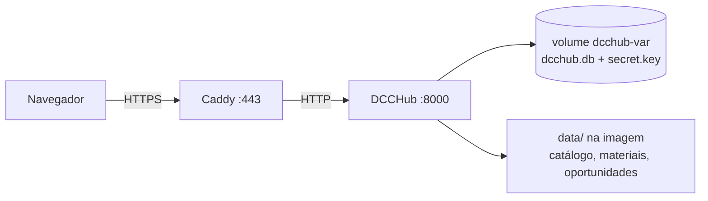

# Deploy

[← README](../README.md)

O DCCHub é um único processo Python com SQLite (~30 MB de RAM). Qualquer VM mínima serve; o essencial é **disco persistente** para o banco — plataformas com disco efêmero (ex.: plano grátis do Render) não servem.

`deploy/` tem tudo:

| Arquivo | Para quê |
|---|---|
| `docker-compose.yml` | DCCHub + [Caddy](https://caddyserver.com) com HTTPS automático (Let's Encrypt) |
| `Caddyfile` | Proxy reverso para o app |
| `.env.example` | `DOMAIN`, `DCCHUB_ADMIN_TOKEN`, `DCCHUB_ACCESS_CODES` |
| `cron.example` | Atualização diária/semanal dos dados e backup diário |
| `backup.sh` | Cópia consistente do banco + chave, guarda 14 dias |
| `fly.toml` | Alternativa no Fly.io (pago, ~US$ 2–3/mês) |



## Onde hospedar

| Opção | Custo | Observação |
|---|---|---|
| **Azure for Students** | grátis (US$ 100/ano de crédito) | Só o e-mail `@ufmg.br`, sem cartão. VM **B1s** cabe no crédito. Recomendado. |
| **Oracle Cloud Always Free** | grátis | VM ARM generosa, mas o cadastro pode exigir dados que pessoa física não tem e falta capacidade com frequência. |
| **GitHub Student Pack** | crédito na DigitalOcean | Também com o e-mail da UFMG. |
| **VPS barata** (ex.: Hetzner CAX11) | ~€ 4/mês | Sem burocracia, permanente. |

## Passo a passo (VM Ubuntu)

### 1. Criar a VM
Ubuntu 24.04, 1 vCPU e 1 GB de RAM bastam. Use sua chave SSH pública e anote o **IP público**.

### 2. Abrir as portas 80 e 443
- **Azure:** em *Networking / Network security group*, libere HTTP (80) e HTTPS (443).
- **Oracle:** libere na *Security List* da VCN **e** dentro da VM (a imagem vem com iptables fechado):
  ```bash
  sudo iptables -I INPUT 6 -p tcp --dport 80 -j ACCEPT
  sudo iptables -I INPUT 6 -p tcp --dport 443 -j ACCEPT
  sudo netfilter-persistent save
  ```

### 3. Domínio
Crie um registro **A** apontando para o IP da VM. Sem domínio, use `IP-COM-TRACOS.sslip.io` (ex.: `20-1-2-3.sslip.io`) ou um subdomínio do DuckDNS — o Caddy obtém o certificado normalmente.

### 4. Docker e código
Na VM:
```bash
curl -fsSL https://get.docker.com | sudo sh
sudo usermod -aG docker $USER && exit        # entre de novo no SSH
sudo mkdir -p /opt/dcchub && sudo chown $USER /opt/dcchub
git clone git@github.com:amaralthalesalves/dcchub.git /opt/dcchub
```

> Repositório privado: adicione uma *deploy key* (chave SSH da VM, só leitura) em **Settings → Deploy keys** do repositório.

### 5. Configurar e subir
```bash
cd /opt/dcchub/deploy
cp .env.example .env
python3 -c "import secrets; print(secrets.token_urlsafe(32))"   # → DCCHUB_ADMIN_TOKEN
nano .env                                                        # DOMAIN, token, código de acesso
docker compose up -d --build
docker compose logs -f caddy                                     # espere "certificate obtained"
```
Abra `https://seu.dominio` — deve aparecer a tela do código de acesso.

### 6. Atualização dos dados e backup
```bash
chmod +x backup.sh
crontab -e        # cole as linhas de deploy/cron.example
```

| Quando | O quê |
|---|---|
| todo dia, 6h | oportunidades |
| segunda, 6h30 | catálogo/oferta + materiais |
| todo dia, 3h | backup do banco e da chave em `deploy/backups/` |

> [!WARNING]
> Os backups ficam na própria VM. **Copie `deploy/backups/` para fora dela** de vez em quando (ex.: `rclone` para o Google Drive). Se a VM for perdida — ou o crédito acabar — sem cópia externa, as avaliações se perdem.

## Atualizando o código

```bash
cd /opt/dcchub && git pull
cd deploy && docker compose up -d --build
```

O banco e a chave ficam no volume `dcchub-var` e sobrevivem a rebuilds. O catálogo vem na imagem; os crons atualizam a cópia dentro do container, e o próximo rebuild volta à versão do repositório até o cron seguinte — rode os syncs localmente e faça commit de `data/` para manter o repositório em dia.

## Restaurando um backup

```bash
cd /opt/dcchub/deploy
docker compose stop app
docker compose cp backups/dcchub-AAAAMMDD-HHMM.db app:/app/var/dcchub.db
docker compose cp backups/secret.key app:/app/var/secret.key
docker compose run --rm -u root app chown -R nobody /app/var   # o app roda como nobody
docker compose start app
```

## Sem Docker

```bash
DCCHUB_DB=/var/lib/dcchub/dcchub.db DCCHUB_TRUST_PROXY=1 DCCHUB_ADMIN_TOKEN=... \
DCCHUB_ACCESS_CODES=... HOST=127.0.0.1 PORT=8000 python3 app.py
```

Coloque atrás de um proxy com HTTPS (Caddy/nginx) e mantenha `DCCHUB_TRUST_PROXY=1` — o app passa a usar `X-Forwarded-For` para o limite de abusos e marca o cookie como `Secure`. Um serviço `systemd` com `Restart=always` cuida de reinícios.
