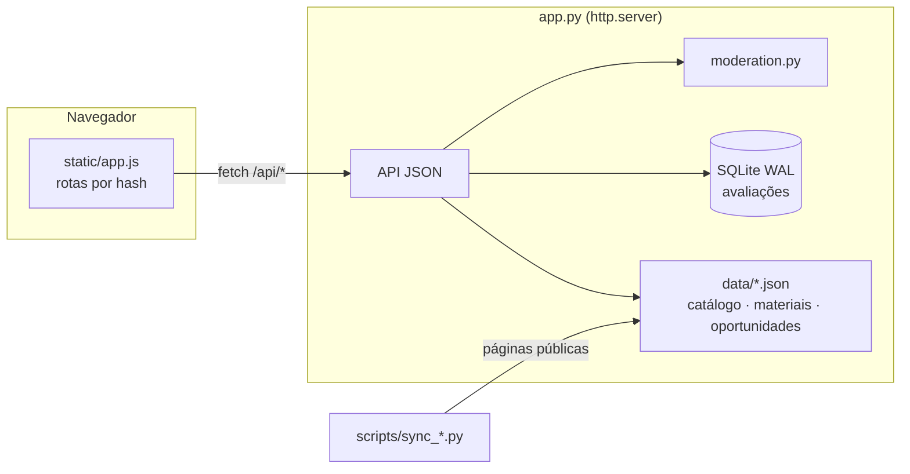

# Desenvolvimento

[← README](../README.md)

## Arquitetura

Sem dependências e sem etapa de build: **Python 3.10+ (biblioteca padrão)**, **SQLite** e uma **SPA em JavaScript puro**.



- **`app.py`** serve os arquivos estáticos e a API, valida e grava avaliações, aplica limites de abuso, código de acesso e cabeçalhos de segurança. Recarrega `data/*.json` sozinho quando os arquivos mudam. Respostas com gzip (~20 KB para carregar o catálogo).
- **`moderation.py`** decide publicar, devolver ou segurar cada comentário. Veja [Moderação](moderacao.md).
- **`static/`** é a interface: `index.html`, `app.js` (rotas como `#/professor/…`, `#/oferta`), `select.js` (seletores estilizados), `style.css` (tokens de cor com modo claro/escuro), `theme.js` e as fotos.
- **`scripts/`** geram os dados a partir das páginas públicas. Veja [Dados](dados.md).

### Estrutura

```
app.py                       servidor HTTP + API JSON
moderation.py                filtro automático de comentários
scripts/
  sync_dcc.py                docentes, disciplinas e ofertas do site do DCC
  audit_catalog.py           confere o catálogo contra todas as ofertas oficiais
  import_sigaa.py            oferta pelo mapa do SIGAA (PDF)
  sync_oportunidades.py      chamadas de dcc.ufmg.br/oportunidades
  sync_provas.py             índice do acervo de materiais (Google Drive)
data/
  catalog.json               catálogo gerado (versionado)
  catalog-arquivo.json       disciplinas extintas
  ofertas-sigaa/             ofertas importadas do SIGAA (só campos mínimos)
  oportunidades.json, provas.json
static/                      SPA sem build + fotos
tests/                       unitários, integração, moderação, seed de demonstração, e2e
deploy/                      docker compose, Caddy, cron, backup
docs/                        esta documentação
```

### Design da interface

Linguagem visual sóbria e institucional: superfícies neutras, **um** azul de destaque (`#1f56a0`), bordas finas em vez de sombras pesadas, sem gradientes, e cor só onde carrega informação (notas, avisos, conflitos). Todas as cores são variáveis em `:root` no `style.css`, redefinidas para o modo escuro. Fontes do sistema — nada é carregado de terceiros.

## Configuração

| Variável | Padrão | Uso |
|---|---|---|
| `DCCHUB_DB` | `data/avaliacoes.db` | Banco SQLite (modo WAL). |
| `DCCHUB_SECRET` | gerado em `secret.key`, ao lado do banco | Chave do HMAC. **Faça backup**: trocá-la desliga as pessoas das próprias avaliações. |
| `DCCHUB_ADMIN_TOKEN` | — | Ativa o painel de moderação em `/#/moderacao`. |
| `DCCHUB_ACCESS_CODES` | — (site aberto) | Código(s) de acesso da comunidade, separados por vírgula. Veja [Comunidade e privacidade](comunidade-e-privacidade.md#o-código-de-acesso). |
| `DCCHUB_TRUST_PROXY` | — | `1` atrás de um proxy confiável: usa o **último** item de `X-Forwarded-For` (o que o proxy viu; os anteriores podem ser forjados), marca o cookie como `Secure` e envia HSTS. |
| `HOST` / `PORT` | `0.0.0.0` / `8000` | Endereço de escuta. |

Os nomes antigos (`AVALIA_DCC_*`) continuam aceitos. O cookie (`avalia_dcc`) e as chaves do navegador (`avalie-*`) mantêm o nome antigo **de propósito**: trocá-los desconectaria todo mundo da própria identidade anônima e apagaria rascunhos e grades salvos.

## API

Todas as rotas respondem JSON. Com `DCCHUB_ACCESS_CODES` definido, tudo exceto `POST /api/access` responde `401 {"gate": true}` sem o cookie de acesso.

| Método | Rota | |
|---|---|---|
| POST | `/api/access` | Troca um código de acesso pelo cookie |
| GET | `/api/bootstrap` | Catálogo, estatísticas e definições do formulário |
| GET | `/api/offerings?term=2026.2` | Turmas do semestre com notas por par docente × disciplina |
| GET | `/api/professors/{slug}` · `/api/courses/{id}` | Detalhes, resumo, histórico e avaliações |
| GET | `/api/reviews?professor=&course=&sort=recent&limit=&offset=` | Lista paginada |
| POST · PUT · DELETE | `/api/reviews` · `/api/reviews/{id}` | Criar · editar · apagar (só quem escreveu) |
| POST | `/api/reviews/{id}/helpful` · `/api/reviews/{id}/report` | Voto útil (alterna) · denúncia |
| POST | `/api/moderation/check` | Avisos de moderação para um rascunho de comentário |
| GET · POST · POST | `/api/me` · `/api/me/code` · `/api/me/restore` | Minhas avaliações · mostrar o código de recuperação (só POST JSON da própria origem, com limite) · recuperar |
| POST · DELETE | `/api/class-reports` | Informar/desfazer "docente X dá a disciplina Y" (só sem oferta oficial) |
| GET | `/api/provas` · `/api/oportunidades` | Materiais e oportunidades |
| GET · POST | `/api/admin/queue` · `/api/admin/reviews/{id}` · `/api/admin/class-reports` · `/api/admin/class-reports/delete` | Moderação (`Authorization: Bearer …`) |

Uma avaliação recusada pela moderação responde `400` com `fields.comment` (mensagens) e `moderation` (categoria, decisão e trecho).

## Testes

```bash
python3 -m unittest discover -s tests -v    # API, moderação, segurança, parsers, versões de disciplina
node --test tests/test_ics.mjs              # gerador de .ics da grade (static/ics.js)
```

Teste de ponta a ponta no Chrome headless (Node 22+, sem dependências), **sempre num servidor temporário** — ele cria e apaga avaliações:

```bash
python3 tests/seed_demo.py /tmp/demo.db
DCCHUB_DB=/tmp/demo.db PORT=8766 python3 app.py &
node tests/e2e_browser.mjs http://localhost:8766
```

> [!CAUTION]
> `tests/seed_demo.py` cria avaliações **fictícias** atribuídas a docentes reais. Use só em bancos temporários — o script se recusa a escrever no banco padrão.

### CI (GitHub Actions)

| Workflow | Quando | O que faz |
|---|---|---|
| [`ci.yml`](../.github/workflows/ci.yml) | todo PR e push no `main` | Testes Python em 3.10 e 3.13; sintaxe do JS; testes do `.ics`; e2e no Chrome com banco de demonstração |
| [`sync.yml`](../.github/workflows/sync.yml) | segunda 6h30 (Brasília) ou manual | Roda os syncs de catálogo, oportunidades e materiais; se `data/` mudou e os testes passam, abre um PR. Falha (e avisa) se algum site mudou de formato |

O `sync.yml` precisa de **Settings → Actions → General → "Allow GitHub Actions to create and approve pull requests"**. PRs abertos por ele não disparam o `ci.yml` (limite do `GITHUB_TOKEN`), por isso os testes rodam dentro do próprio sync.

## Convenções

- Sem dependências externas no servidor e no navegador. Se algo precisar de uma, discuta antes.
- Textos da interface em português, com acentuação.
- Mudou uma regra de moderação ou do sync? Adicione um caso de teste — o ataque/erro **e** o caso legítimo parecido que não pode quebrar.
- Nunca versione relatórios do SIGAA (`*.pdf`), bancos (`*.db`), `secret.key` ou `.env`.
